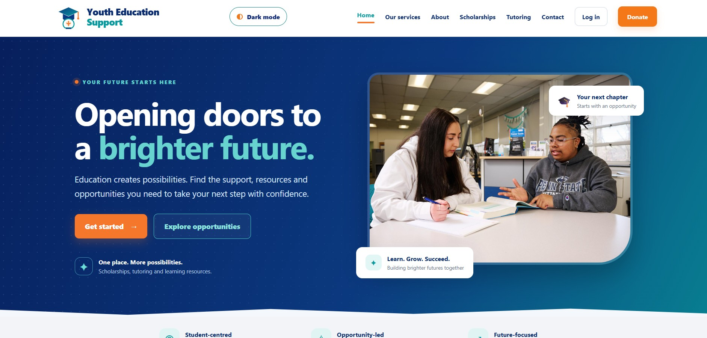
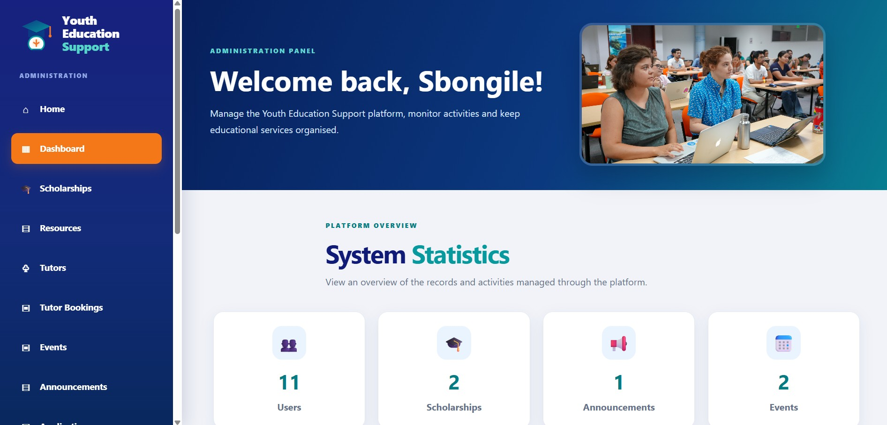
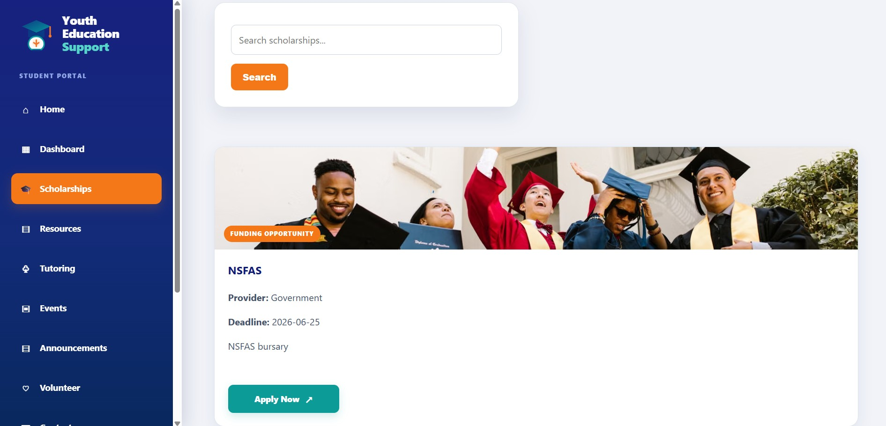

# Youth Education Support

## 1. Project Overview

Youth Education Support is a web-based system developed as part of our Work Integrated Learning (WIL) project. The main aim of the system is to help students access educational opportunities, study resources and support services in one place.

The system provides features that allow students to create accounts, explore scholarships, access study materials, book tutoring sessions and stay updated with announcements and events. Students can also register as volunteers, make donations, send messages and manage their profiles.

Administrators can use the admin dashboard to manage users and other records available in the system.

## 2. Technologies Used

The project uses the following technologies:

- **PHP** – handles the website's server-side functionality.
- **MySQL** – stores user information and other system records.
- **HTML** – structures the web pages.
- **CSS** – controls the layout and appearance of the website.
- **JavaScript** – supports interactive website features.
- **XAMPP** – provides the local development environment for running PHP and MySQL.

## 3. Main Features

### 3.1 Student Features

Students can use the system to:

- Register for an account and log in.
- View available scholarships and submit applications.
- View available tutors and book tutoring sessions.
- Access study materials and educational resources.
- View announcements and upcoming events.
- Register for volunteering opportunities.
- Make donations through the available donation features.
- Send messages through the contact page.
- Manage their profiles.

### 3.2 Administrator Features

The admin dashboard provides management features for:

- User accounts.
- Scholarships.
- Tutors and tutoring records.
- Events and announcements.
- Volunteer records.
- Donations.
- Contact messages.

The available actions depend on the management pages implemented in the project.

## 4. Technologies and Database

The system uses a MySQL database to store and manage its information.

**Database name:** `youth_education_support`

**SQL database file:** `youth_education_support.sql`

The database contains tables for the main system features, including users, scholarships, tutoring, study materials, events, announcements, donations, contact messages and volunteering.

## 5. Installation and Setup

Follow these steps to run the website on a Windows computer.

### Step 1: Install XAMPP

Download and install XAMPP if it is not already installed on your computer.

### Step 2: Start Apache and MySQL

1. Open the XAMPP Control Panel.
2. Start Apache.
3. Start MySQL.
4. Check that both services are running.

### Step 3: Copy the project folder

Copy the `YouthEducationSupport` project folder into:

```text
C:\xampp\htdocs\
```

The main project folder should therefore be located at:

```text
C:\xampp\htdocs\YouthEducationSupport\
```

### Step 4: Create and import the database

1. Open your browser and go to `http://localhost/phpmyadmin`.
2. Create a database named `youth_education_support`, unless it already exists.
3. Select the database.
4. Open the **Import** tab.
5. Choose `youth_education_support.sql`.
6. Click **Import** or **Go**, depending on your phpMyAdmin version.
7. Wait for the import to finish successfully.

**Important:** If the database already contains project data, export a backup before importing the SQL file again. Importing it into an existing database may cause errors or affect existing data, depending on the SQL statements.

### Step 5: Check the database connection

Open `db.php` in the project folder and check that the database settings match your local XAMPP installation.

For the standard local XAMPP setup, the settings normally look like this:

```php
<?php
$host = "localhost";
$user = "root";
$password = "";
$database = "youth_education_support";

$conn = mysqli_connect($host, $user, $password, $database);

if (!$conn) {
    die("Database connection failed.");
}
?>
```

Use this example only if it matches the structure of your existing `db.php`. Do not replace a working database connection file without checking the rest of the project first.

### Step 6: Open the website

Open your browser and visit:

```text
http://localhost/YouthEducationSupport/
```

The website should load if Apache is running, the project folder is in the correct location and the database connection is configured correctly.

## 6. User Roles

### Student

Students can register, log in and access the student features available to their accounts.

### Administrator

Administrators have access to the admin dashboard and its management features. Administrative access should be limited to authorised accounts.

## 7. Project Screenshots

The following screenshots can be used to demonstrate the website's interface. Make sure the image files exist in the `screenshots` folder and that the filenames match the references below.

### Home Page



### Student Dashboard


### Admin Dashboard



### Scholarships Page



### Tutors Page


## 8. Testing and Quality Checks

- The website opens in the browser.
- Registration and login work as expected.
- Students can access the features available to their accounts.
- Administrator access is restricted to authorised users.
- Database records can be viewed and managed through the relevant pages.
- Forms validate the information entered by users.
- Study materials and other links work correctly.
- The website displays properly on different screen sizes.

## 9. Source Control and Project Management

The project source code and documentation can be maintained in Azure DevOps. Commits should describe the changes made, while work items can be used to track tasks and progress.

The repository README should be kept up to date whenever important project features or installation instructions change.

## 10. Conclusion

Youth Education Support was developed to bring several educational support services together in one web-based system. It aims to make it easier for students to find educational resources, explore scholarships and access support opportunities.

This project also gave our group practical experience in developing a website, connecting PHP to a MySQL database, designing user interfaces and working with software development tools.

## 11. Authors

Developed by the group members as part of the Work Integrated Learning project.

- **ST10452101** – Tshiamo Tumelo Simango
- **ST10172741** – Keoagile Letlape
- **ST10354054** – Thoriso Maenetja
- **ST10387277** – Khothatso Qobolo

**Module:** XISD6329 – Work Integrated Learning
