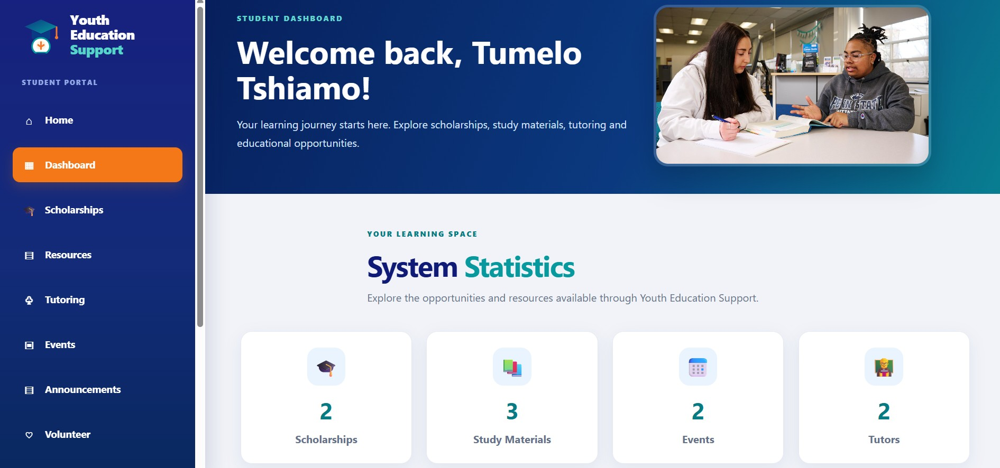
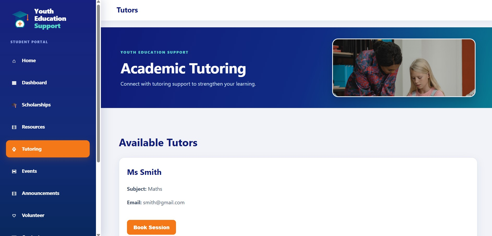

# Youth Education Support

## 1. Project Overview

Youth Education Support is a web-based educational support system developed as part of our Work Integrated Learning (WIL) project.

The main purpose of the system is to provide students with a central platform where they can access educational opportunities, learning resources and support services. It aims to make it easier for students to find useful information and manage different educational activities in one place.

The platform allows students to register, log in, explore scholarship opportunities, access study materials, find tutoring support, view announcements and upcoming events, manage their profiles and communicate with administrators.

The system also provides an administrator dashboard where authorised administrators can manage users and maintain important website information.

## 2. Project Objectives

The main objectives of Youth Education Support are to:

- Provide students with easier access to educational opportunities.
- Make scholarship information more accessible.
- Provide access to study materials and educational resources.
- Support tutoring and educational activities.
- Improve communication between students and administrators.
- Provide a centralised platform for educational announcements and events.
- Allow administrators to manage website information through a dedicated dashboard.

## 3. Technologies Used

The project was developed using the following technologies:

| Technology | Purpose |
|---|---|
| PHP | Handles server-side functionality and application logic. |
| MySQL | Stores user information and other system records. |
| HTML5 | Structures the website pages. |
| CSS3 | Controls the website layout, styling and responsiveness. |
| JavaScript | Supports interactive website functionality. |
| Google Identity Services | Provides Google Sign-In authentication. |
| XAMPP | Provides the local Apache and MySQL development environment. |
| Git | Tracks changes to the project source code. |
| GitHub | Hosts the project repository. |
| Azure DevOps | Supports source control and project management. |

## 4. Main System Features

### 4.1 Student Features

Students can use the website to:

- Create an account and log in.
- Sign in using Google where Google authentication has been configured.
- View available scholarship opportunities.
- Search for educational opportunities.
- View scholarship details and application links.
- Access study materials and downloadable PDF resources.
- Find tutoring-related information and support.
- View announcements and upcoming educational events.
- Access frequently asked questions.
- Manage their personal profiles.
- Change their account passwords.
- Send messages through the contact page.
- Access the available donation and volunteering features.

### 4.2 Administrator Features

The administrator dashboard provides management functionality for the website.

Depending on the implemented management page, administrators can:

- View and manage registered users.
- Manage scholarship information.
- Manage study materials and uploaded PDF documents.
- Manage educational events.
- Create and manage announcements.
- View and manage contact messages.
- Access other available administrative management functions.
- Generate administrator invitation tokens.

Administrator accounts require an authorised invitation token during registration. This helps control the creation of administrator accounts.

### 4.3 Authentication and Account Management

The website supports two authentication methods:

**Email and password authentication**

Users can register and log in using their email addresses and passwords.

**Google Sign-In**

The website integrates Google Identity Services to allow users to authenticate using their Google accounts.

The system also includes password validation, password confirmation during registration, session management and role-based access to the appropriate dashboards.

### 4.4 User Interface

The website includes:

- A modern and responsive interface.
- Consistent navigation and page layouts.
- A light and dark mode option on supported pages.
- Form validation and user feedback messages.
- Interactive elements for easier navigation.

## 5. Database Design

The website uses a MySQL relational database to store and manage information.

**Database name:** `youth_education_support`

The database supports the different functions of the system, including:

- User accounts and authentication.
- Scholarship information.
- Tutoring information.
- Study materials.
- Events and announcements.
- Donations and volunteering records.
- Contact messages.
- Administrator invitation records.

The exact tables depend on the database schema and migrations installed for the project.

### Database Configuration

The database connection is managed through the project's `db.php` file.

For a standard local XAMPP installation, the connection commonly uses:

- Host: `localhost`
- Username: `root`
- Password: Empty by default, unless configured otherwise.
- Database: `youth_education_support`

The database settings should match the local MySQL configuration.

## 6. Security and Validation

Security was considered during the development of the website.

The system includes several measures to improve the protection of user information and application functionality:

- Prepared SQL statements to reduce the risk of SQL injection.
- Password hashing before storing passwords in the database.
- Password verification during login.
- Input validation on registration and other forms.
- CSRF protection on supported forms.
- Session ID regeneration after successful login.
- Session management and inactivity timeout handling.
- Role-based access control for students and administrators.
- One-time administrator invitation tokens with expiry and usage checks.
- Secure handling of uploaded study materials and PDF downloads.
- Output escaping to reduce the risk of cross-site scripting.

These measures help improve the reliability and security of the system.

## 7. Installation and Setup

The following instructions explain how to run the website locally on a Windows computer using XAMPP.

### Step 1: Install XAMPP

Download and install XAMPP if it is not already installed.

XAMPP provides Apache and MySQL, which are required to run the website locally.

### Step 2: Start Apache and MySQL

1. Open the XAMPP Control Panel.
2. Start Apache.
3. Start MySQL.
4. Confirm that both services are running.

### Step 3: Download or Clone the Project

Clone the GitHub repository:

```bash
git clone https://github.com/tumelots07/YouthEducationSupport.git
```

Alternatively, download the repository as a ZIP file and extract it.

Place the project folder inside:

```text
C:\xampp\htdocs\
```

For the cloned repository, the expected folder location is:

```text
C:\xampp\htdocs\YouthEducationSupport
```

If you use a different folder name, your local website URL must match that folder name.

### Step 4: Create the Database

1. Open your browser.
2. Visit `http://localhost/phpmyadmin`.
3. Create a database named:

```text
youth_education_support
```

4. Import the project's database SQL file if it has been provided separately.
5. If database migrations are supplied, apply the required migrations to the database.

Important: Some database changes are provided through separate SQL migration files. Apply the migrations required by the version of the website you are installing.

Back up an existing database before importing or applying SQL changes. Do not overwrite an existing database containing important records without first creating a backup.

### Step 5: Configure the Database Connection

Open `db.php` and check that the database connection settings match your local XAMPP installation.

A standard local configuration commonly uses:

```php
<?php
$host = "localhost";
$user = "root";
$password = "";
$database = "youth_education_support";
?>
```

Use the actual connection structure already implemented in the project. Do not replace a working database connection file without checking its existing configuration.

### Step 6: Configure Google Sign-In

Google Sign-In requires a Google Identity Services Web Client ID.

1. Create or access a Google OAuth Web Client through Google Cloud Console.
2. Configure the authorised JavaScript origin for your local development environment.
3. Open `google_config.php`.
4. Add your own Google Web Client ID in the appropriate configuration setting.
5. Make sure the required Google authentication database migration has been applied.
6. Test Google Sign-In using your local website.

Do not publish private credentials, client secrets or sensitive configuration values in the public repository.

### Step 7: Open the Website

Open your browser and visit:

```text
http://localhost/YouthEducationSupport/
```

The website should load if Apache is running, the project files are in the correct location and the database connection has been configured correctly.

## 8. User Roles

### Student

Students can create accounts, log in and access the educational features available to their accounts.

### Administrator

Administrators have access to the administrator dashboard and the management functions assigned to their accounts.

Administrative access is restricted to authorised accounts.

## 9. Project Screenshots

Screenshots can be included to demonstrate the website's interface and functionality.

Place the screenshot files inside the `screenshots` folder and ensure that their filenames match the references below.

### Home Page


### Student Dashboard



### Administrator Dashboard


### Scholarships Page


### Tutoring Page



Additional screenshots may be included to demonstrate registration, login, Google Sign-In, study materials, events and profile management.

## 10. Testing and Quality Checks

The following areas should be checked when testing the website:

- Home page loads successfully.
- Student registration works correctly.
- Input validation displays appropriate messages.
- Email and password authentication works.
- Google Sign-In works when correctly configured.
- Students are redirected to the appropriate dashboard.
- Administrators can access the administrator dashboard.
- Unauthorised users cannot access restricted administrative pages.
- Scholarship information displays correctly.
- Search functionality works.
- Study materials and PDF downloads work.
- Events and announcements display correctly.
- Contact messages can be submitted and managed.
- Profile information and password management work.
- Database records can be created, viewed, updated and deleted where implemented.
- The website displays correctly on different screen sizes.

## 11. Source Control and Project Management

Git was used to track changes and maintain the project's source code.

The project is maintained in the following repositories:

**GitHub:**

https://github.com/tumelots07/YouthEducationSupport

**Azure DevOps:**

https://dev.azure.com/YouthEducationSupport/YouthEducationSupport/_git/YouthEducationSupport

Both repositories were synchronised after merging their development histories. The latest shared version includes the website updates and Google Sign-In functionality.

Commits are used to document changes, while repository management supports collaboration and project maintenance.

## 12. Future Improvements

Possible improvements for future development include:

- Expanding the available scholarship opportunities.
- Improving the tutoring booking process.
- Adding further reporting and analytics features.
- Improving the donation process.
- Extending automated testing.
- Enhancing the website's accessibility and user experience.
- Adding further authentication and account management options.

## 13. Conclusion

Youth Education Support was developed to bring educational opportunities, learning resources and support services together in one web-based platform.

The website provides students with access to scholarships, study materials, tutoring information, announcements, events and other useful services. It also gives administrators tools to manage users and maintain the system.

The development of this project provided practical experience in PHP development, MySQL database management, website design, authentication, security and source control.

Overall, Youth Education Support demonstrates how web technology can be used to make educational support services more accessible and organised.

## 14. Authors

Developed by the group members as part of the Work Integrated Learning project.

- **ST10452101** – Tshiamo Tumelo Simango
- **ST10172741** – Keoagile Letlape
- **ST10354054** – Thoriso Maenetja
- **ST10387277** – Khothatso Qobolo

**Module:** XISD6329 – Work Integrated Learning
